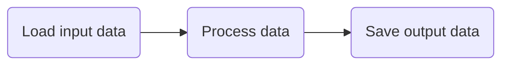
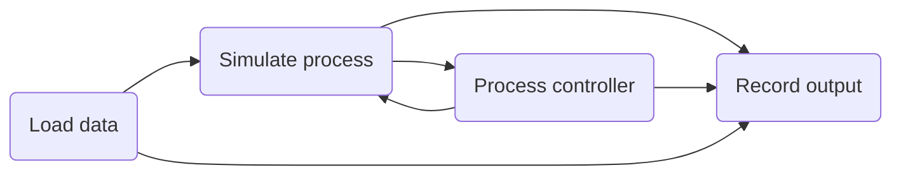

If you enjoy learning by following examples, we recommend diving straight into the [tutorials](../../examples/tutorials/hello-world/) section. All of the tutorials and demos can be found in our [Github repo](https://github.com/plugboard-dev/plugboard/tree/main/examples).

This section introduces some of the key concepts in Plugboard and how to apply them when building your own models.

## Terminology

### Components

The basic building blocks of Plugboard models are [`Component`][plugboard.component.Component] objects. Typical uses of components are:

* Loading data into and saving data out of models;
* Preparing data and/or running calculations;
* Modelling a particular physical entity, e.g. within a model of a factory production line, you might define separate components representing the conveyor belts, sensors and workstations;
* Making calls to external systems, e.g. fetching data from the internet, calling an LLM, spinning up a subprocess to run some third-party simulation software.

When implementing your own components, you will need to:

* Subclass the base [`Component`][plugboard.component.Component];
* Specify its inputs and ouputs using an [`IOController`][plugboard.component.IOController];
* Define a `step()` method the executes the main logic of your component for a single step; and
* Optionally define an `init()` method to do any required preparatory steps before the model in run.
* In the case of event based models, define custom [`Event`][plugboard.events.Event] subclasses and corresponding event handler methods decorated with `Event.handler`.

#### Optional input and output types

Declare port types by passing a mapping of names to Python types to `IOController`:

```python
from plugboard.component import Component, IOController as IO


class Double(Component):
    io = IO(inputs={"value": int}, outputs={"result": int})

    async def step(self) -> None:
        self.result = self.value * 2
```

Existing lists of names still work: `IO(inputs=["value"], outputs=["result"])`
declares both ports as `typing.Any`. You can mix a list on one side with a typed
mapping on the other, or use `Any` explicitly for individual ports. Attribute
annotations alone do not declare port types or directions. Mapping declarations
provide runtime metadata; add ordinary attribute annotations separately if you
want your editor or static type checker to check `self.value` and `self.result`.

Supported types are `Any`, Python classes, unions such as `int | None`, and
`list[T]`, `dict[K, V]`, `set[T]`, `frozenset[T]`, fixed-length `tuple[T, U]`, and
variable-length `tuple[T, ...]`. These can be nested. `None` in a declaration
means `type(None)`. Other typing constructs, including string forward references,
`TypeVar`, `Literal`, `Annotated`, `TypedDict`, and protocols, raise `IOSetupError`.
Use an ordinary class for a nominal check of an array, dataframe, or other custom
payload; its internal contents, shape, and dtype are not inspected.

Ports inherited from a base component retain their types. A name-only declaration
does not erase an inherited type. Adding a type to an inherited `Any` port is
allowed; conflicting explicit types raise `IOSetupError`, including conflicts
between multiple base classes.

The same syntax works for ports chosen at instance construction. For example,
this component creates its output names from a configuration list:

```python
from plugboard.schemas import ComponentArgsDict
from typing import Unpack


class DynamicSource(Component):
    # A class declaration is still needed for the component lifecycle.
    io = IO(outputs=["ready"])

    def __init__(self, fields: list[str], **kwargs: Unpack[ComponentArgsDict]) -> None:
        super().__init__(**kwargs)
        self.io = IO(
            outputs={"ready": bool, **{name: int for name in fields}},
            input_events=self.io.input_events,
            output_events=self.io.output_events,
            namespace=self.name,
            component=self,
            runtime_validation="deep",
            validate_outputs=True,
        )
        self._fields = fields

    async def step(self) -> None:
        self.ready = True
        for field in self._fields:
            setattr(self, field, 42)
```

Keep constructor arguments serializable when using YAML configuration or JSON
state backends. The example accepts a list of names and constructs the Python
types inside the component. Type declarations in component code also work when
the component is selected through YAML; there is no YAML type-expression syntax.

#### Type validation

Process initialization checks declared output-to-input compatibility, even when
runtime checking is disabled. For example, `Dog` output can connect to `Animal`
input when `Dog` subclasses `Animal`; the reverse fails with `ValidationError`.
All possible members of an output union must be accepted by the input. Mutable
containers (`list`, `dict`, `set`) are invariant, so `list[Dog]` cannot connect to
`list[Animal]`; `tuple` and `frozenset` allow narrower element types. Each edge of
a fan-in or fan-out is checked. `Any` and unknown element types of bare containers
allow a connection without proving its compatibility.

Runtime value checks are **off by default**. Enable them per controller:

```python
io = IO(
    inputs={"samples": list[float], "label": str | None},
    outputs={"average": float},
    runtime_validation="deep",
    validate_outputs=True,
)
```

| Option | Behavior |
| --- | --- |
| `runtime_validation="off"` | No runtime value checks; initialization still checks declarations. |
| `runtime_validation="shallow"` | Check each supplied input's outer type, without checking container contents. |
| `runtime_validation="deep"` | Also check supported container contents and tuple lengths. |
| `validate_outputs=True` | Apply the selected runtime mode to outputs before buffering and sending. Defaults to `False`. |

Runtime validation uses `isinstance` semantics: subclasses are accepted, including
`bool` for `int`. There is no numeric widening or coercion: an `int` is not a
`float`, and a string containing digits is not an `int`. Union members follow the
same rules. Values are checked in place, without converting or copying them.

Input checks cover channel messages, initial values, and direct assignments
(including event handlers) when inputs are bound for a step. A missing input is
not checked, while an explicitly supplied `None` must match its declared type.
Output checks run once per port before fan-out. Failures raise `ValidationError`
with the component, port, expected and actual types, and a nested path where
available, and mark the component as failed. Union failures report the union at
the point where no alternative matches. Process execution may wrap failures in an
`ExceptionGroup` or a Ray task error.

Validators are built when the controller is created and reused for every value;
untyped ports have no validators. Deep checks visit container contents on every
message, so their cost grows with payload size. Use shallow checks for large
payloads when checking only their outer class is sufficient. Validation policy
belongs to each `IOController` declaration: a subclass declaring a new controller
should specify its desired policy, and dynamically replaced controllers should
do the same. Class controllers pass their policy to component instances.

### Connectors

Data flows between components via **Connectors**. You will need to use these to tell Plugboard how data should flow between your components. Your overall model might be very simple, for example:



However Plugboard supports much more complex model structures, including looping and branching:



For models with explicitly declared input and output fields, connectors for each input-output pair must be defined explicitly using one of the [`Connector`][plugboard.connector.Connector] implementations. Connectors required for any events used in the model will be created for you automatically. 

### Processes

Components and connectors are collected together under a **Process**. This top-level class takes care of starting the model and running it until completion. Model execution is broken down into discrete _steps_. Running a model means executing all steps for each component until all of the available data has flowed through the model. The `step()` method advances the model forward by a single step. The `run()` method will repeatedly call `step()` until completion.

Plugboard supports both bounded and unbounded data streams. That is to say, you can either run a model with a fixed size input data set until completion, or run a model indefinitely which will continuously process new inputs as they arrive until a shutdown signal is received.

Plugboard uses Python's **asynchronous concurrency** to schedule execution of each of the components. Don't worry if asynchronous Python is unfamiliar to you: Plugboard takes care of all the details, so that you can focus on the logic of your model.

These Process classes are currently available which can be extended with custom implementations:

* [`LocalProcess`][plugboard.process.LocalProcess] runs models in a single Python process on your computer. This is useful for initial development, and is often sufficient for models are not computationally demanding.
* [`RayProcess`][plugboard.process.RayProcess] allows you to execute components on different Python processes using the [Ray Framework](https://docs.ray.io/en/latest/). This supports parallel computation on a single machine and scales out to large-scale [compute clusters](https://docs.ray.io/en/latest/cluster/getting-started.html).

## Running models

Most models start out life in a Jupyter notebook or Python script. Later on in development you may choose to convert the Plugboard process definition to a YAML file. This allows you to:

* Separate your model code from its configuration;
* Run the model via Plugboard's CLI - see `plugboard process run --help` for details;
* Transfer your model to a cluster to take advantage of larger-scale computational resources.
